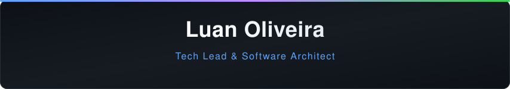

<div align="center">

<!-- Header Banner -->


<!-- Snake Animation -->
<picture>
  <source media="(prefers-color-scheme: dark)" srcset="https://raw.githubusercontent.com/in100tiva/in100tiva/output/github-contribution-grid-snake-dark.svg">
  <source media="(prefers-color-scheme: light)" srcset="https://raw.githubusercontent.com/in100tiva/in100tiva/output/github-contribution-grid-snake.svg">
  
</picture>

<br/>

<!-- Typing Effect -->
[](https://git.io/typing-svg)

<br/>

<!-- Social Links -->
[](https://linkedin.com/in/luanpdd)
[](https://youtube.com/@thecrowdev)
[](mailto:projetoin100tiva@gmail.com)

</div>

---

### Architecture & Focus

```typescript
interface Profile {
  role: "Tech Lead & Software Architect";
  domains: [
    "High-Performance Distributed Systems",
    "Autonomous AI Agents & RAG Architecture",
    "Multi-Tenant SaaS Infrastructure"
  ];
  coreLanguages: ["Go", "Rust", "Python", "TypeScript", "SQL"];
  infrastructure: ["Docker", "Linux", "PostgreSQL", "pgvector", "Redis"];
  flagshipProject: "KeyHybrid — Zero-Knowledge AI Gateway";
}
```

---

### Core Technologies

<div align="center">

#### Languages


#### Systems & Infrastructure


</div>

---

### Featured Systems

<div align="center">

| Project | Architecture & Scope | Core Stack |
|:---|:---|:---|
| [**KeyHybrid**](https://github.com/in100tiva/KeyHybrid) | Zero-knowledge vault for AI provider keys + local OpenAI-compatible gateway: virtual tokens, AES-256-GCM at rest, multimodal proxy (`/v1/chat`, `/v1/audio`, `/v1/videos`) | Go, Rust, Tauri, Svelte |
| [**Phone Webcam**](https://github.com/in100tiva/webcam) | Turns a phone into a system webcam over WiFi: WebSocket streaming, virtual camera driver, signed installers for Linux, Windows and Android | Electron, Node.js, FFmpeg |
| [**whitelist-proxy**](https://github.com/in100tiva/whitelist-proxy) | Local HTTP/HTTPS proxy with allow/deny rules, live configuration and a web UI for non-technical operators | Go, concurrency, networking |
| [**mvp-vale**](https://github.com/in100tiva/mvp-vale) | Mobile-first salary-advance management: employee requests, approval workflow and balance tracking | React, Vite |

</div>

Each repository documents setup, architecture decisions and trade-offs — not just a quickstart.

---

### Availability

> Open to selected freelance engagements: backend architecture, AI integration (LLM, RAG, agents) and full-stack delivery.
> Long-term partnerships welcome.

---

<div align="center">

*"Clean architecture is not about following rules. It is about building systems that withstand change."*

</div>
